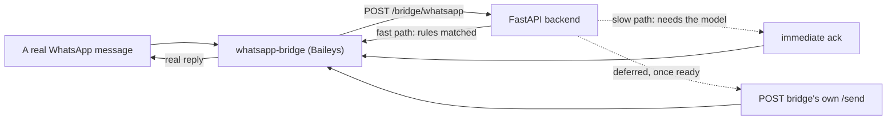
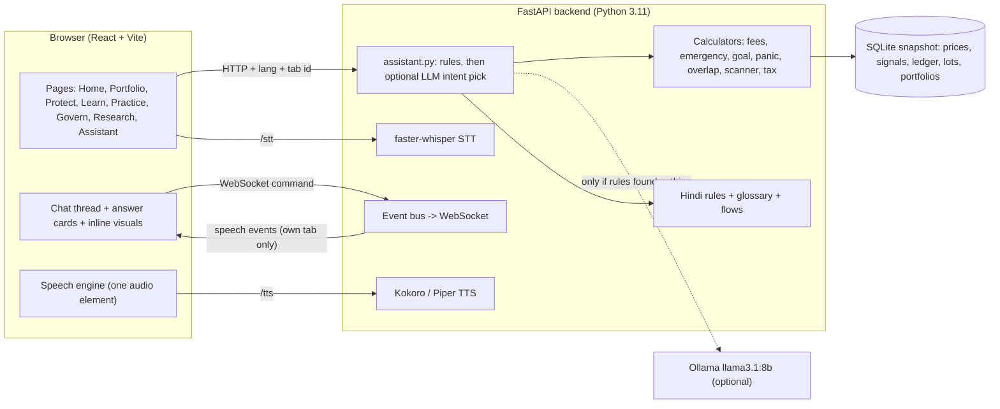
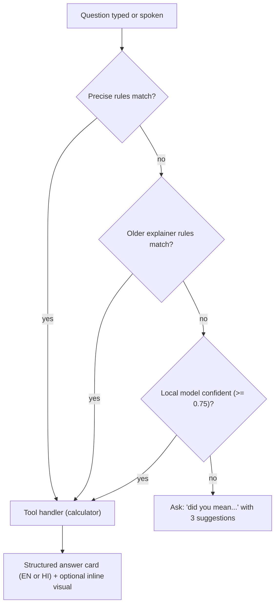

# JARVIS // ALPHA OS

**A free, local, bilingual (English / हिन्दी) assistant that helps ordinary Indian savers protect their money, understand it, and keep it honest.**

[](docs/TESTING.md)


> Not an alpha engine and not investment advice. Every number on screen is computed by code you can read, not guessed by an AI.
> Paper trading only. No broker, no real money, no cloud.

| Voice + text assistant | Fund overlap |
|---|---|
|  |  |
| **Scam call rehearsal** | **Tip scanner + tax shield** |
|  |  |

More screenshots: [docs/FEATURES.md](docs/FEATURES.md).

---

## Why it exists

Three things routinely cost Indian households money, and none of them needs a prediction to fix:

1. **Scams.** Fake bank-KYC calls, "digital arrest" video calls, WhatsApp "guaranteed return" groups. They work because victims are rushed and alone.
2. **Hidden costs and duplication.** Two mutual funds that hold the same shares. A "small" 2% fee that eats a third of 20 years of growth.
3. **Panic and no safety net.** Selling at the bottom of a crash; no idea how many months of cash they have.

JARVIS makes each of those *visible and interactive*: you drag a slider, replay a crash on your own holdings, rehearse the scam call, and see the arithmetic.

## Who it helps

| If you are... | JARVIS gives you... |
|---|---|
| A salaried or retail investor with 8-20 stocks or a few mutual funds | A portfolio X-ray, fee and overlap checks, a tax shield, a goal chart |
| A first-time investor | Plain-language answers, a glossary, "every number is a door" explanations |
| Someone whose parents get "bank officer" calls | A scam-call rehearsal in English or Hindi, by voice or text |
| Most comfortable in Hindi | The whole assistant, visuals and guided steps in Hindi (see [LANGUAGE](docs/LANGUAGE.md)) |
| A student or judge who wants to see how it works | Glass-box explanations, a hash-chained ledger, a time machine, honest test numbers |

## What is inside

| Area | Features | Details |
|---|---|---|
| **Assistant** | Voice and text chat; structured answer cards; inline interactive visuals; saved funds; nine guided jobs | [ASSISTANT](docs/ASSISTANT.md) |
| **Protect** | **Scam recovery coach**, stock-tip scanner, tax shield, panic-sell replay, standing "tell me if" rules | [FEATURES](docs/FEATURES.md#protect) |
| **Rural** | Moneylender interest checker, "is this offer real?", government-scheme finder, document readiness, harvest/wage income planner | [RURAL](docs/RURAL.md) |
| **WhatsApp / SMS** | The same tools by message (numbered menu, voice notes, Hindi) — a Twilio-ready webhook and browser simulator, **plus a live, no-cloud WhatsApp bridge and SMS gateway** (this fork) | [MESSAGING](docs/MESSAGING.md), [below](#live-messaging-whatsapp--sms-no-twilio-no-cloud) |
| **Learn / Practice** | Goal chart, fund overlap, fee-drag slider, emergency-fund meter, weekly spoken digest, scam call rehearsal, glossary, drill-downs | [FEATURES](docs/FEATURES.md#learn-and-practice) |
| **Govern** | Risk firewall, rebalance simulator, tamper-evident audit ledger and tamper test | [FEATURES](docs/FEATURES.md#govern) |
| **Research** | **Search and analyse any listed stock**, four AI analysts and a forced dissenter, citation gate, time machine, calibration | [GOVERNANCE_ENGINE](docs/GOVERNANCE_ENGINE.md) |
| **Voice** | Local neural voices (Kokoro, Piper), instant Stop, local Whisper speech-to-text | [VOICE](docs/VOICE.md) |
| **Bilingual** | English and Hindi chosen per screen, including **speaking and typing Hindi**; hand-written Hindi with numbers placed by code | [LANGUAGE](docs/LANGUAGE.md) |

## Live messaging: WhatsApp + SMS, no Twilio, no cloud

The base project already ships a provider-independent message handler
([backend/messaging.py](backend/messaging.py)) behind a Twilio-shaped webhook — menu, numbered
choices, Hindi, voice notes, rate limiting, all channel-agnostic. This fork adds **two real,
no-cloud transports** on top of it, built the same evening this section was written, so the
status below is honest about what's proven versus what's built-but-unverified.

### Why not just use Twilio?

Twilio works, costs money past a trial tier, and for WhatsApp specifically requires a Meta
Business verification process (display-name approval, a registered business, real lead time).
The goal here was **free and immediate**: a real number a person can message today, with
nothing leaving this machine except the message itself.

### WhatsApp — live, two numbers paired, verified end-to-end

**Architecture**: [`whatsapp-bridge/`](whatsapp-bridge/) is a small Node/TypeScript service using
[`@whiskeysockets/baileys`](https://github.com/WhiskeySockets/Baileys) — a re-implementation of
WhatsApp's real multi-device protocol over a raw WebSocket, no browser, no Puppeteer. It links to
a WhatsApp account the same way WhatsApp Web does (pairing code, not QR — works headless), then
forwards every inbound message to a new backend endpoint, `POST /bridge/whatsapp`
([backend/app.py](backend/app.py)), which calls the existing `messaging.handle()` unchanged.



**Why this is unofficial, and what that costs.** Baileys is not Meta's API — it's a reverse-
engineered client, against WhatsApp's Terms of Service, and the account can be banned or logged
out with no warning and no appeal. That's a real, accepted trade for zero cost and zero approval
process, not an oversight. `whatsapp-bridge/auth*/` (the linked session's actual Signal Protocol
keys — equivalent to a password) is gitignored and **never** committed.

**What's actually been verified, live, not just in theory:**
- Two real numbers paired and connected simultaneously against one backend.
- A genuine message round-trip: real phone → real WhatsApp delivery → bridge → backend →
  calculator → reply → back through WhatsApp to the real phone.
- The **ack-then-async** pattern: `assistant.will_need_model()` (new, `backend/assistant.py`)
  cheaply predicts — before ever touching Ollama — whether a question needs the local model. If
  yes, the bridge gets an immediate "let me check…" instead of risking a timeout, and the real
  answer follows once Ollama responds, delivered via a deferred callback. Verified the real
  answer arrives in the right order, with the guided-flow logic fully intact (not a simplified
  duplicate of the synchronous path).
- **Multi-number correctness**: each bridge instance reports its own callback URL on every
  request (`bridge_url` in the payload) rather than the backend assuming one fixed address — so
  a deferred reply for number A can never be delivered through number B's connection.
- **Resilience**: a reconnect attempt that itself throws no longer crashes the whole bridge
  process (it used to — this was found live, from a real disconnect, not hypothesized); a
  backend that's unreachable when a message arrives gets an apology sent back instead of silence.
- A real crash was hit and diagnosed live during development (`stream error 515` → WhatsApp
  logging the session out), recovered by clearing `auth/` and re-pairing — documented in
  [DEPLOY.md](DEPLOY.md) as an expected, recoverable event, not a mystery.

### SMS — backend complete and tested, hardware pairing in progress

**Architecture is deliberately simpler than WhatsApp's**: no persistent socket, no Node process.
[SMS Gateway for Android](https://github.com/capcom6/android-sms-gateway) (Apache 2.0, local/
private mode) turns a spare Android phone into a stateless REST endpoint on the local network —
the phone POSTs inbound texts to a webhook, and a reply is just one POST back to the phone's own
`/message` endpoint. New: [`backend/sms_gateway.py`](backend/sms_gateway.py) (the outbound
sender, mirroring the existing Twilio-REST helper's shape) and `POST /bridge/sms`
([backend/app.py](backend/app.py)) — same `messaging.handle()`, same `will_need_model()`
ack-then-async wiring, plus a `messageId` dedupe guard for webhook retries.

**Status, stated honestly:**
- ✅ `render_answer()`/`_pack()`'s existing SMS-length formatting (520/330 char cap, multi-segment
  splitting) was already built and tested before this fork touched anything — confirmed still
  correct against the new endpoint.
- ✅ The endpoint itself: fast path, slow-path ack, and dedupe all verified live against the
  running server with synthetic payloads shaped exactly like the gateway app's real webhook.
- ✅ 3 new tests in `tests/test_messaging.py`, full suite green.
- 🚧 **Real device pairing is not yet complete.** The gateway app's on-device registration flow
  turned out to ask for an invite token from a "web dashboard" rather than exposing a pure
  zero-account local mode as initially expected — still being worked through. The backend side
  is finished and waiting; what's left is entirely on-device setup, documented step by step in
  [DEPLOY.md §9](DEPLOY.md).
- **Known trade-off**: unlike the WhatsApp bridge, there's no process independent of the backend
  here — if the backend is down when a text arrives, nothing can apologize, because the thing
  that would reply is the thing that's down. Stated plainly rather than hidden.

### Also fixed along the way

- **Speech-to-text was silently broken** on Python 3.13 (`faster-whisper` + `av` version
  incompatibility — `TypeError: open() got an unexpected keyword argument 'metadata_errors'`,
  every transcription failing with a misleading "I could not make that out, try again," which
  actively told users to retry something that would never succeed). Fixed by moving the backend
  to **Python 3.11** (`.venv311`), where pip resolves a compatible `av` automatically. Verified
  with a real transcript, not just an import check.
- `requirements.txt` pins corrected: `yfinance` (0.2.51 had stopped working against Yahoo's
  current API entirely — portfolio prices were silently empty), `nsepython` (the pinned version
  had been yanked from PyPI), `python-multipart` (missing — WhatsApp/Twilio form-body parsing
  was crashing with a 500), `jugaad-data` removed (unused anywhere in the codebase, and its own
  pin conflicted with `yfinance`'s).
- Top nav bar fix: a silent horizontal-scroll overflow could hide the last page links with zero
  visual cue — now wraps instead, so no page link can ever go invisible regardless of viewport
  width or how long the portfolio-name button happens to be.

### Full deployment runbook

[DEPLOY.md](DEPLOY.md) — sizing a VPS, `docker-compose.yml` (backend + Ollama + the WhatsApp
bridge + Caddy for automatic HTTPS), the one-time WhatsApp pairing steps, and the SMS gateway
setup including the Android battery-optimization gotcha that nothing else documents.

## Architecture at a glance



Full write-up: [docs/ARCHITECTURE.md](docs/ARCHITECTURE.md).

## How a question is answered



The model may only **pick which tool to run**. It never writes an answer and never produces a number. Measured accuracy on sentences written after the rules were tuned is in [docs/ASSISTANT.md](docs/ASSISTANT.md#measured-accuracy).

## Quick start

Prerequisites: Python 3.11, Node 18+, and (optional but recommended) [Ollama](https://ollama.com) with `llama3.1:8b`.

```bash
pip install -r requirements.txt
python tools/ingest.py              # build the frozen data snapshot (~5 min)
python tools/get_voice.py           # download the Piper and Kokoro voices (~400 MB, one time)
cd frontend && npm install && npm run build && cd ..
python -m uvicorn backend.app:app --port 8000
```

Open <http://localhost:8000>. Pick **EN** or **हिन्दी** at the top right. Open the **Assistant** page and tap the orb, or type.

Developer mode (hot reload): `npm run dev --prefix frontend` serves the UI at `:5173`.

```bash
python -m pytest tests/ -q          # 385 tests
```

Detailed setup, environment variables and troubleshooting: [docs/SETUP.md](docs/SETUP.md).

## Repository layout

```
analysis/   calculators: tools.py (fees, emergency), goal.py, panic.py, scanner.py, shield.py,
            stress.py, xray.py, rebalance.py, attribution.py, factors.py, tax.py
backend/    app.py (FastAPI + WebSocket) · assistant.py (routing + handlers) · explain.py (original explainer)
            practice.py / practice_hi.py (funds, scam scenarios) · digest.py · flows.py / flows_hi.py
            vernacular.py + hindi_rules.py + hindi_page_rules.py + glossary_hi.py (Hindi)
            ledger.py · sandbox.py · watchlist.py · drilldown.py · tts.py · bus.py · session.py
agents/     research desks, citation gate, orchestrator, local-LLM client
core/       frozen event contract, SQLite schema, point-in-time store
risk/       policy, portfolio, the deterministic risk engine
voice/      stt.py (faster-whisper)
ingest/     data adapters with point-in-time safety tiers
frontend/   React + Vite + Three.js (pages, components, stores)
whatsapp-bridge/  Node/TypeScript Baileys bridge -- links a real WhatsApp number, forwards to
            /bridge/whatsapp, sends deferred replies back via its own /send (this fork)
config/     policy profiles, universe, demo script
docs/       the documentation set (see below)
tests/      385+ tests incl. blind routing-evaluation sets and the new SMS-bridge tests
tools/      ingest, voice download, demos, dry run, calibration backfill

Dockerfile, docker-compose.yml, Caddyfile, DEPLOY.md  -- production deployment (this fork)
```

## Documentation

| Document | What it covers |
|---|---|
| [docs/FEATURES.md](docs/FEATURES.md) | Every feature: what it does, who it is for, how it works, limits (with screenshots) |
| [docs/ARCHITECTURE.md](docs/ARCHITECTURE.md) | Components, request lifecycle, event bus, per-screen language, stores |
| [docs/ASSISTANT.md](docs/ASSISTANT.md) | Intent routing, handlers, answer cards, evaluation numbers, how to add an intent |
| [docs/VOICE.md](docs/VOICE.md) | TTS/STT engines, Stop semantics, hands-free, latency |
| [docs/LANGUAGE.md](docs/LANGUAGE.md) | The bilingual design and how to add a language |
| [docs/API.md](docs/API.md) | Every HTTP/WebSocket endpoint |
| [docs/DATA.md](docs/DATA.md) | The snapshot, tables, config files, sample fund data, tax constants |
| [docs/FRONTEND.md](docs/FRONTEND.md) | Pages, components, stores, styling, i18n helper |
| [docs/TESTING.md](docs/TESTING.md) | Test suites, blind evaluation sets, honest numbers |
| [docs/SAFETY_AND_PRIVACY.md](docs/SAFETY_AND_PRIVACY.md) | What stays local, what it will not do, scam-safety principles |
| [docs/SETUP.md](docs/SETUP.md) | Install, models, environment variables, troubleshooting |
| [docs/ROADMAP.md](docs/ROADMAP.md) | Known gaps and what to build next |
| [docs/GOVERNANCE_ENGINE.md](docs/GOVERNANCE_ENGINE.md) | The original core: time machine, research desks, firewall, calibration |
| [SPEC.md](SPEC.md) | The original build plan |
| [DEPLOY.md](DEPLOY.md) | **This fork**: production deployment, the WhatsApp bridge pairing steps, the SMS gateway setup |

## Design rules

1. **The model never produces a number.** Figures come from calculators; text comes from templates.
2. **The risk engine never imports an LLM.** Arithmetic approves or blocks.
3. **Say what you do not know.** Unsure means ask, not guess. Samples are labelled as samples.
4. **Local and free.** No paid API, no cloud, no raw data leaves the machine.
5. **Language is the user's choice,** per screen; nothing is forced into Hindi or English.
6. **Interrupt anything.** Stop cuts the voice mid-word and ends any inline briefing or call.

## Honest limits

- Mutual-fund holdings are **illustrative samples**, not live factsheets. Real data import is on the [roadmap](docs/ROADMAP.md).
- The tip scanner understands **English** tips only.
- Prices are a **frozen snapshot**, not live; there is no broker and no real money.
- No research desk beats a coin flip; the project says so and builds around it ([GOVERNANCE_ENGINE](docs/GOVERNANCE_ENGINE.md)).
- Voice quality and Hindi speech recognition on real voices have to be judged by a human listener.
- The optional language-model stage needs Ollama; without it the assistant asks instead of guessing.

## Tech stack

Python 3.11 · FastAPI · SQLite · faster-whisper · Kokoro / Piper TTS · Ollama (llama3.1:8b) · React 18 · Vite · Three.js / react-three-fiber · zustand · lightweight-charts · pytest
Node 22 / TypeScript + Baileys (WhatsApp bridge) · Docker Compose + Caddy (deployment) — this fork

Hotkeys (assistant): `SPACE` hold to speak · `/` focus the box · `Esc` stop speaking · `T` presenter mode · `Ctrl+K` search everything.

## License and attribution

Research and education prototype. Market data via free public sources (see [docs/DATA.md](docs/DATA.md)); verify before relying on any figure. Not financial advice.
